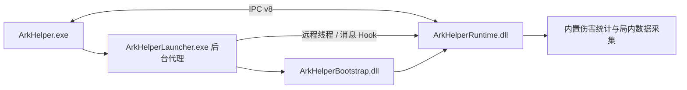

# 架构

ArkHelper 独立构建和分发，不依赖相邻 Framework 目录。

## 目录

| 目录 | 内容 |
| --- | --- |
| src | Win32/D2D 桌面界面、覆盖层、PRTS 客户端、配置与启动器 |
| native/core | 内部模块生命周期、服务、任务和 Hook 安全排空 |
| native/modules | 伤害统计、当前战斗数据与 IPC 发布 |
| native/loader、native/bootstrap | 私有运行时的加载与引导 |
| include/arkhelp | 桌面与运行时共享协议 |
| tests、tools | 回归测试与开发工具 |
| third_party | MinHook 源码和工具链运行库许可 |

## 线程与生命周期

Unity 对象读取在游戏主线程 Update 回调中执行，运行时工作线程消费复制的数据并发布快照。桌面线程绘制，网络和缓存 I/O 在独立工作线程执行。

运行时只接受静态注册的内置模块。`ARKHELP_ENABLE_TEST_MODULES` 仅用于独立生命周期测试，测试对象文件与生产对象文件分开；正式 DLL 不编译外部插件加载、目录扫描或旧输入适配。

停止时依次排空发布、服务、回调和原生 Hook。未排空时保留状态以便重试；私有 DLL 保留到游戏进程结束，完整停止后可以在同一进程重新启动。

## 数据与本地状态

- IPC v8、StageOverview v1；桌面和运行时必须配套更新。
- 配置 v6，保存到 `config/arkhelp.json`，原子替换写入。
- 仅保留当前战斗的关卡、单位实例和统计，不加载或下载完整关卡库。
- PRTS 仅按需缓存已查询的页面与头像；默认 500 MiB，可修改上限和路径。
- 日志在 `logs/`、`runtime/logs/`，战斗 CSV 在 `runtime/exports/`。

首次使用由独立说明窗拦截，连续前台阅读超过 10 秒、勾选并保存确认后才发布后台连接标记。单实例锁本身不会启用游戏连接。

1.0.0 已移除旧独立设置窗口、游戏内 PRTS 客户端、离线关卡包加载器、旧面板状态、停用的投影探测代码及未使用的 ImGui 依赖。来源关系与仍保留的注入机制见 [关联审计](framework-separation-audit.md)。
